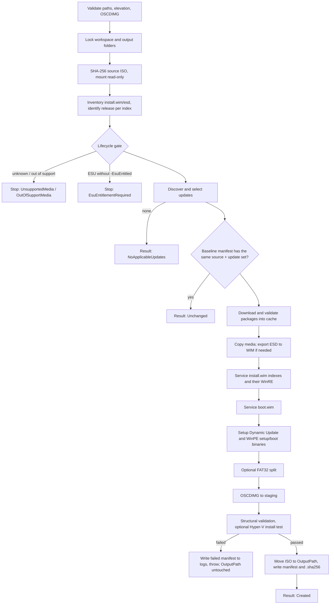

# 🏗️ Architecture

Agent working notes: [AGENTS.md](../AGENTS.md).

## 🗂️ Layout

```text
src/WindowsIsoServicing/
  WindowsIsoServicing.psd1 / .psm1     Module manifest and loader
  Data/OperatingSystems.psd1           Release, servicing-model and lifecycle data
  Public/                              Exported commands (one per file)
  Private/
    Environment.ps1                    External process execution, path validation, locks, free space, signatures
    Logging.ps1                        Structured JSON-lines log
    OperatingSystem.ps1                Release identification and lifecycle gating
    IsoMedia.ps1                       ISO mount, media inventory, boot configuration, media copy
    UpdateDiscovery.ps1                Title classification, selection, MSRC and supersedence checks, checkpoint roles, repository source
    MicrosoftUpdateCatalog.ps1         Microsoft Update Catalog requests and page parsers (the only file that may use them)
    MsrcSecurityUpdate.ps1             MSRC Security Updates API (CVRF): security baseline per release
    PackageCache.ps1                   Download, hash and Authenticode validation, cache index
    ImageServicing.ps1                 DISM servicing of WinRE, install.wim, boot.wim and setup media
    IsoBuild.ps1                       OSCDIMG lookup and build, file naming, FAT32 split
    Manifest.ps1                       Manifest schema, read/write, update-set signature
    Validation.ps1                     Structural validation and Hyper-V installation test
    Workspace.ps1                      Per-run workspace layout and cleanup
scripts/Invoke-IsoServicingPipeline.ps1  Unattended runner for CI and Task Scheduler
scripts/Invoke-QualityGate.ps1           Lint (including skill definitions), parse check and unit tests (wrapped by the Makefile)
scripts/Build-ModulePackage.ps1          Builds and validates the PowerShell Gallery package (.nupkg) and its build report
scripts/Publish-ModulePackage.ps1        Publishes a validated package with Publish-PSResource
.agents/skills/                        Agent skills (Codex reads them here), plus _shared/engineering-standards.md
.claude/skills/                        Claude Code pointer files to .agents/skills
.github/workflows/                     CI and Patch Tuesday workflows
tests/Unit, tests/Integration          Pester tests
tests/live/                            Live end-to-end servicing run, independent result verification and Hyper-V installation test (no Pester)
```

## 🔄 Update-WindowsISO flow



`finally` always runs: leftover mounts under the run workspace are discarded, the ISO is dismounted, the workspace is
removed (unless `-KeepWorkspace`), and the locks are released.

## 🧭 Design decisions

- **Native tooling only.** The DISM PowerShell cmdlets handle mount, add-package, dismount, export and split. `dism.exe` is called only for `/Cleanup-Image`, which has no cmdlet, with `/English` and explicit exit-code handling. OSCDIMG comes from the installed Windows ADK Deployment Tools, or from `-OscdimgPath` ([requirements.md](requirements.md#-oscdimg)); the module ships no Microsoft executables. Its Microsoft signature is checked before every use. The boot sector files come from the source media, so OSCDIMG is the only ADK file used.
- **Public Microsoft update sources only.** The MSRC Security Updates API provides the security baseline, and the Microsoft Update Catalog provides discovery, supersedence and files. The host's Windows Update and WSUS configuration is never used. The Catalog has no documented API; its page parsing is isolated in `MicrosoftUpdateCatalog.ps1` and fails with `CatalogFormatChanged` when the pages change. See [update-discovery.md](update-discovery.md).
- **Data-driven release model.** Every per-release difference lives in `Data/OperatingSystems.psd1`: separate or combined servicing stack, checkpoint updates, Dynamic Update availability, lifecycle dates and title product text. The servicing code branches on these flags, not on build numbers. The one exception is `setuphost.exe`, which Microsoft documents as build 26100 and later.
- **Locks** are lock files opened with `FileShare.None`, so a lock is released when its process exits.
- Source-media protection, publication gating and tolerated DISM errors are hard constraints in [INVARIANTS.md](../INVARIANTS.md).

## 🧾 Manifest

Schema version 1, written next to the ISO as `<iso>.json`. Main sections:

| Section | Content |
| --- | --- |
| `source` | File name, path, SHA-256, size, volume label, image format |
| `operatingSystem` | Release key, name, version, build, architecture, language, servicing model |
| `output` | File name, SHA-256, size, servicing month, image format (`wim`/`swm`), boot modes |
| `updates` | KB, category, title, release month, OS build, update ID, package files with role and SHA-256 |
| `images.install` | Per index: edition, serviced flag, lifecycle, version before/after, rollup package version before/after, WinRE result, applied packages, installed package list |
| `images.boot` | Per boot.wim index: versions and applied packages |
| `images.setupMedia` | Setup Dynamic Update and replaced setup/boot files |
| `validation` | `passed`, structural checks, boot test result (`performed: false` when not run) |
| `toolVersion`, `runId`, `createdAt`, `servicing` | Provenance and timestamps |

`Get-WindowsISOManifest` validates the schema, and `Publish-WindowsISO` refuses manifests where `validation.passed` is false.

## 📝 Logging

Each run writes `<LogPath>\<runId>.log.jsonl`. Each line holds `timestamp`, `level`, `operation`, `target`, `message`
and optional `data`. DISM writes per-operation logs (`dism-<component>-<package>.log`) to the same folder. Console output
uses the Information, Warning and Verbose streams.
